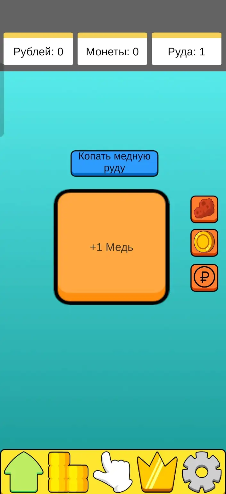
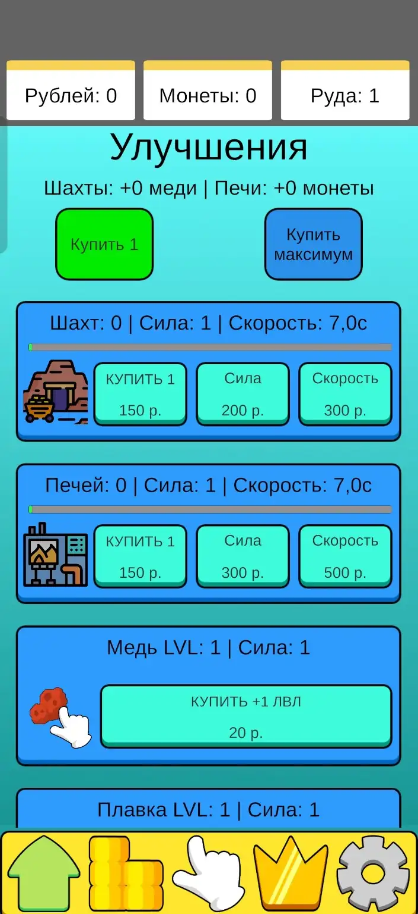
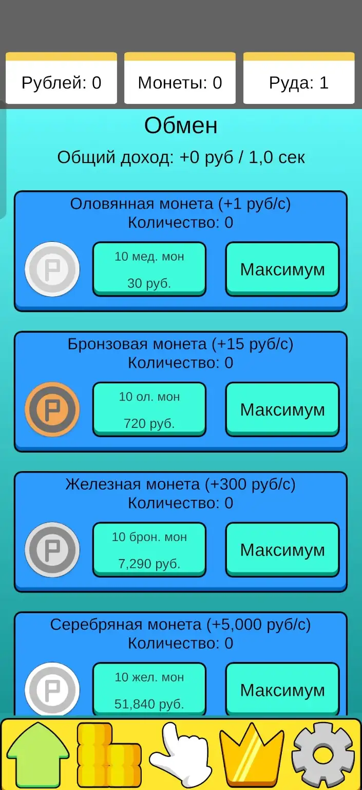
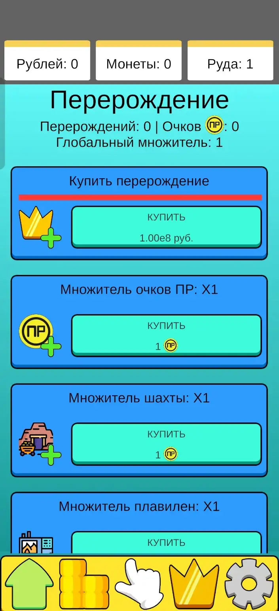
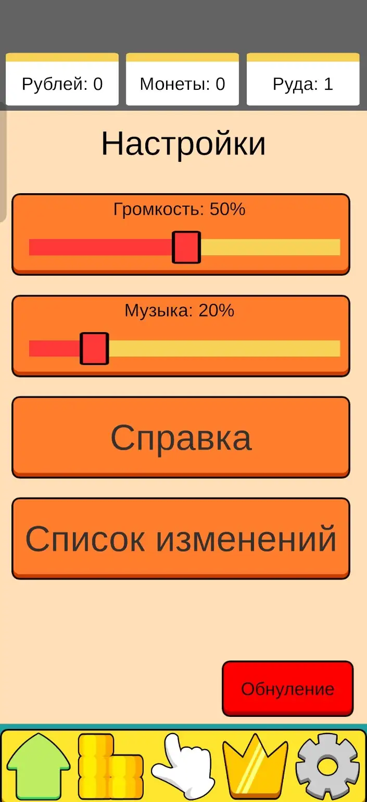
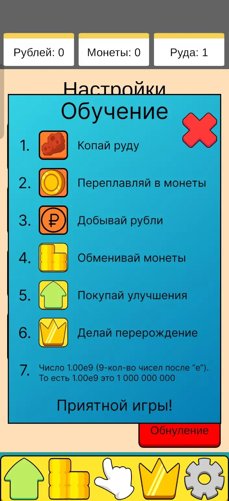

# MergeGame ⛏️

**MergeGame** — мой личный проект на Unity и C#. Это уже третья попытка сделать свою небольшую игру. В этот раз я решил попробовать себя в создании кликера с добычей ресурсов, улучшениями и постепенным развитием производства.

## Об игре

Игрок начинает с ручной добычи медной руды, переплавляет её в монеты и зарабатывает деньги. Постепенно можно покупать шахты и плавильни, улучшать их скорость и производительность и автоматизировать получение ресурсов.

Монеты можно обменивать на монеты более высоких уровней. Также есть система **перерождения (престижа)**: она позволяет сбросить основной прогресс и получить постоянные бонусы для дальнейшего развития.

## Что реализовано

- Ручная добыча руды и переплавка монет.
- Шахты, плавильни и улучшения.
- Автоматическое производство и пассивный доход.
- Обмен монет разных уровней.
- Система престижа.
- Сохранение игры и доход за время отсутствия.
- Настройки звука.

## 📸 Скриншоты игры

| Главный экран | Улучшения | Обмен монет |
| :---: | :---: | :---: |
|  |  |  |

| Перерождение | Настройки | Обучение |
| :---: | :---: | :---: |
|  |  |  |

## Технологии

**Unity · C# · Android**

## Android-версия

Последняя собранная версия игры для Android.

[📥 Скачать MergeGame.apk](https://disk.yandex.ru/d/O4eKQRlhi1dbXQ)

## Исходный код

В репозитории сохранены скрипты, сцены и ресурсы Unity. Это не полный Unity-проект: папки `Packages` и `ProjectSettings` здесь отсутствуют.
